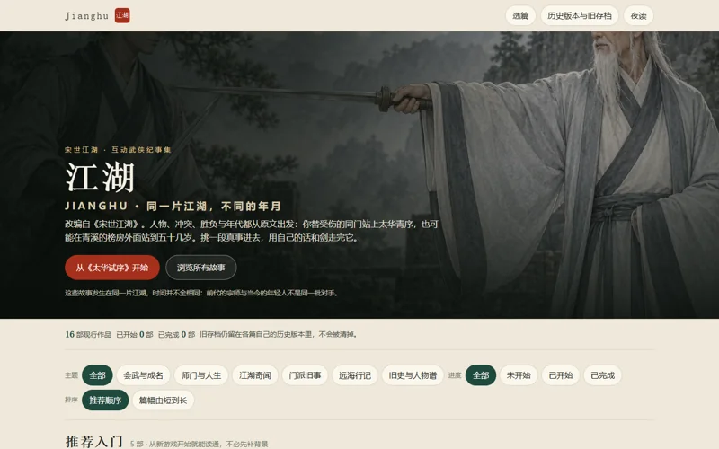
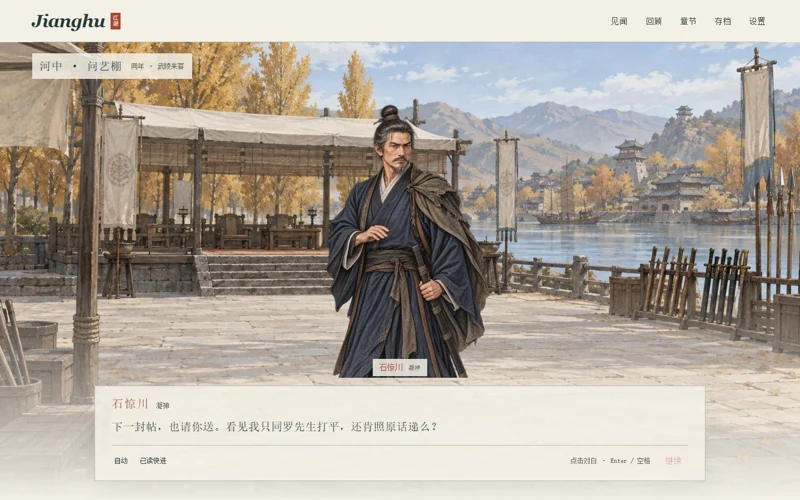

<h1 align="center">⚔️ JIANGHU</h1>

<p align="center">
  <strong>The great battles are part of history. Your place in them is not.</strong>
</p>

<p align="center">
  《宋世江湖》——根据作者原典改编的互动武侠纪事集。<br />
  见证胜负，回应人物，在不能随意改写的江湖历史里，决定自己如何参与。
</p>

<p align="center">
  <a href="https://seiya058904.github.io/jianghu/"><strong>▶ 进入江湖</strong></a>
  &nbsp;·&nbsp;
  <a href="#choose-your-story">📖 选择篇目</a>
  &nbsp;·&nbsp;
  <a href="#the-experience">🎭 游玩体验</a>
  &nbsp;·&nbsp;
  <a href="#run-locally">⚙️ 本地运行</a>
</p>

<p align="center">
  <sub>16 部作品 &nbsp;·&nbsp; 23 个现行篇章入口 &nbsp;·&nbsp; 分篇独立存档 &nbsp;·&nbsp; 中文互动叙事</sub>
</p>

<p align="center">
  <a href="https://github.com/seiya058904/jianghu/actions/workflows/verify.yml">
    
  </a>
  &nbsp;
  <a href="https://github.com/seiya058904/jianghu/actions/workflows/deploy-pages.yml">
    
  </a>
</p>

<p align="center">
  
  <br />
  <sub>《太华试序》 · 项目内实际使用的篇章美术</sub>
</p>

---

> **江湖不只有天下第一，也有那些注定无法成为天下第一的人。**
>
> 你可能是临时补位的武当弟子、跟随师门赴会的年轻门人、被让过招的王府少年，或是一名只想把朋友带回家的普通人。原典里的生死与重要胜负有自己的重量；你的观察、问话、选择和回应，决定你如何走过这一段故事。

<a id="the-experience"></a>
## 🎭 Stories You Step Into · 不是旁观的武侠故事

<p align="center"><code>ENTER A SCENE → READ &amp; RESPOND → MAKE A CHOICE → LIVE WITH THE ECHO</code></p>

<table>
  <tr>
    <td width="50%" valign="top">
      <h3>📚 多部独立纪事</h3>
      <p>16 部作品组织为不同主题与年代，包含 23 个现行篇章入口。可以从单篇开始，也可以沿相关人物与事件继续阅读。</p>
    </td>
    <td width="50%" valign="top">
      <h3>⚖️ 选择改变参与方式</h3>
      <p>问什么、帮谁、如何回话，都可能带来后续反应；但选择不是用来推翻原典已经确定的重要生死、胜负和人物关系。</p>
    </td>
  </tr>
  <tr>
    <td width="50%" valign="top">
      <h3>🎨 有人物的文字舞台</h3>
      <p>对白、人物立绘与分层场景共同组织叙事。阅读器让你进入当下的冲突，而不是只翻阅静态资料集。</p>
    </td>
    <td width="50%" valign="top">
      <h3>💾 能继续的长篇阅读</h3>
      <p>逐句自动保存、三个手动槽、JSON 导入导出与历史版本隔离。每一篇都有自己的进度，不用一次读完。</p>
    </td>
  </tr>
  <tr>
    <td width="50%" valign="top">
      <h3>🌙 纸本与夜读</h3>
      <p>可选字号、文字速度、夜读模式与减少动态效果；支持键盘操作，也为较窄视口准备了独立布局。</p>
    </td>
    <td width="50%" valign="top">
      <h3>📦 按篇离线阅读</h3>
      <p>已下载并缓存完整的作品可离线继续。历史旧稿放在独立入口中，不会与当前主目录混作同一版本。</p>
    </td>
  </tr>
</table>

<a id="choose-your-story"></a>
## 📖 Choose Your Story · 从哪一篇开始？

**第一次进入，推荐先读《太华试序》《龙门问刀》或《第十二席》。** 三篇分别偏向比武、师门见闻与人物一生。

| 篇目 | 你的身份与眼前的事 | 开始阅读 |
| :--- | :--- | :--- |
| **太华试序** | 作为武当替补弟子参加六门旧会，面对真实的胜负与差距 | [进入篇章 →](https://seiya058904.github.io/jianghu/taihua.html) |
| **龙门问刀** | 随镇河门赴秋会，看人问刀、试剑，再决定自己要往哪里去 | [进入篇章 →](https://seiya058904.github.io/jianghu/longmen.html) |
| **第十二席** | 从一位王府少年的不甘心开始，追问什么才算一场没有让招的较艺 | [进入篇章 →](https://seiya058904.github.io/jianghu/twelfth-life.html) |
| **青石五友** | 从少年同伴走到垂暮之年，理解能力、友情与留下的代价 | [进入篇章 →](https://seiya058904.github.io/jianghu/qingshi.html) |
| **山河璧** | 从两名撞进同一间密库的盗玉人，到十三文牵出的粮库谜事 | [密库双贼 →](https://seiya058904.github.io/jianghu/jade-thieves.html) · [十三文 →](https://seiya058904.github.io/jianghu/jade.html) |
| **死人争榜** | 一个死去十八年的名字正在争回榜次；你要分清谁在赢、谁该记名 | [进入篇章 →](https://seiya058904.github.io/jianghu/dead-ranking.html) |

作品库还收录《照水刀》《北枪与乾坤》《一剑两脉》《海路两世》《玄门旧史》《白石谷外》等故事及其关联篇目；部分配篇需要完成前置阅读。不同年代的人物不会被当成同一批对手。

**[浏览全部作品、现行篇章与历史旧稿 →](https://seiya058904.github.io/jianghu/)**

## 🖼️ From the Library to the Stage · 游戏实景

以下为仓库保留的浏览器验收截图，用于展示作品库与对话舞台；它们是**历史验收画面**，不代表每个最新版本都与截图逐像素相同。

<table>
  <tr>
    <td width="55%" align="center" valign="top">
      
      <br />
      <sub>作品库 · 从不同作品与年代中选择入口</sub>
    </td>
    <td width="45%" align="center" valign="top">
      
      <br />
      <sub>对话舞台 · 人物、场景与文字选择</sub>
    </td>
  </tr>
</table>

<a id="play-and-controls"></a>
## 🎮 Read Your Way · 操作与阅读

- **推进对白：**点击舞台或对白，也可以按 Enter / 空格；打字演出期间的首次点击会先补全文字。
- **由你决定回复：**选择出现时，需要玩家亲自作答；自动播放与已读快进不会替你选。
- **调整阅读环境：**提供 18 / 20 / 22 / 24 字号、纸本／夜读、文字速度与减少动态效果；Tab 导航控件，Esc 关闭面板。
- **保存与带走进度：**每句自动保存，另有三个手动存档槽、上一程和 JSON 导出／导入。不同作品与版本的存档彼此区分。

> [!IMPORTANT]
> **存档不是云同步。** 进度保存在浏览器环境中；不同设备、浏览器与网站来源不会自动共享。清理网站数据前请先导出存档。离线首开仅对已经下载并缓存的作品有效。

<a id="run-locally"></a>
## 🚀 Play Online or Run Locally

### 🌐 直接在浏览器阅读

**[打开 Jianghu 作品库 →](https://seiya058904.github.io/jianghu/)**

由 GitHub Pages 托管，无需安装客户端。正式部署进度可查看上方 GitHub Actions 状态徽章。

### 💻 从源码运行

需要 **Node.js 24** 与 npm。在项目根目录执行：

```bash
npm ci
npm run build
npm start
```

随后访问 **http://127.0.0.1:4173/**。构建会编译故事、检查 TypeScript、生成网页及离线资源清单。

<details>
<summary><strong>测试命令与完整开发入口</strong></summary>

```bash
npm run dev               # Vite 开发服务器
npm test                  # 自动发现的运行时、存档与叙事测试
npm run test:editorial    # 编辑稿约束测试
npx playwright install chromium
npm run test:e2e          # 浏览器交互与离线验证
npm run audit:v7          # V7 故事节奏与覆盖审计
npm run audit:independent # 独立运行时与素材审计（图片扫描需 Python + Pillow）
```

本项目使用 **TypeScript · Vite · Ink / inkjs · Playwright**。文书与对话来自作者编写的内容，不使用在线 AI 动态生成剧情。

</details>

## 🛠️ Under the Hood · 仓库地图

```text
story/                作者源、Ink 故事与编译流程
src/generated/        生成的剧情数据
src/player.ts         阅读器入口与运行逻辑
src/vn-runtime.ts     叙事状态与场景运行时
src/vn-ui.ts          舞台界面与交互
src/library.ts        作品库
src/works-registry.ts 作品分组、现行篇章与历史版本
public/art/           人物、背景与篇章插画
scripts/              剧本构建、离线清单与审计
tests/                叙事、存档、页面与兼容性回归
docs/                 原典约束、创作记录、验证证据
```

想了解作品编排、继续创作或提交修改，可以从这些资料开始：

- [作品与版本](docs/v7/WORKS_AND_VERSIONS.md) · [文档索引](docs/README.md)
- [原典不可变更约束](docs/lore/CANON_RULES.md) · [内容迁移规则](CONTENT_MIGRATION.md) · [AI / 开发协作约定](AGENTS.md)
- [独立终审验收](docs/audits/independent-final/FINAL_ACCEPTANCE.md) · [后续体验验证](docs/audits/experience-2026-10-18/FINAL_VALIDATION.md)
- [发布与本机文件边界](docs/PUBLISHING.md) · [原始证据索引](docs/evidence/README.md)

最新代码与发布状态应以 `main` 和 [Actions](https://github.com/seiya058904/jianghu/actions) 为准。历史审核文件保留其当时的时间、版本和结论，不用于替代现行验证。

## 📜 Canon & Rights · 原典与使用边界

《宋世江湖》是有固定历史、人物与力量层次的作者原典。改编应尊重已经确定的生死、胜负、年龄、门派、榜次及相关事实；玩家选择不能随意重写原典。

本仓库**没有附带统一的开源许可证**。公开可见不等于授予原典文本、角色、美术或代码的再分发与改编权利。相关素材记录和工程约束请参见仓库文档。

---

<p align="center">
  <sub>NOT EVERY SWORD BECOMES A LEGEND. EVERY PERSON HAS A STORY.</sub><br />
  <sub>《宋世江湖》 · 在胜负之外，走进人的一生。</sub>
</p>
