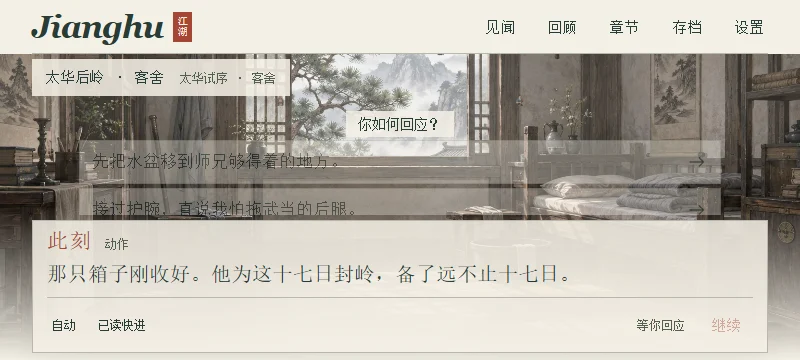
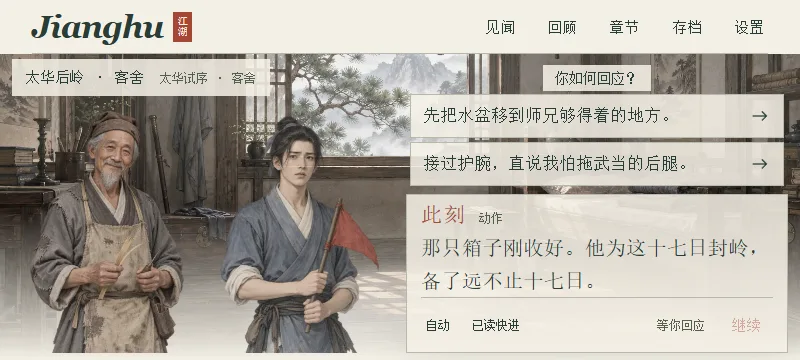

# 画面复验 · 体验 RC 808954f

普通横屏/青石21张锚点的原始复验批次为e34ea6e；最终808954f另修特写镜头，相关38项已重测。各批代际保留，未覆盖旧图。

本轮使用系统 Chrome 155.0.8059.40、真实本地 `dist`，未使用静态背景模拟游戏。代理目视结论与DOM/图片解码结果分开记录。没有重制或替换原画；选中的两张库内证据都是800px宽WebP，原PNG留在项目外。

## 已覆盖范围

|批次|实际范围|证据等级|
|---|---|---|
|入口扫描|23现行入口×360×800、390×844、412×915、800×360、1366×768、1440×900、1920×1080，共161次|基线Chrome自动尺寸/可见按钮中心命中；不是161张剧情目视图|
|六旗舰首选|六篇×360/800/1440三档，18次真实封面进入、推进、选择|基线截图逐帧审阅；字号18/20/22/24、纸本/夜读、减弱动态有分配覆盖|
|短横屏修后|六篇×纸本/夜读，统一800×360、24px；每个选项滚动、命中、选后刷新|正式构建12张截图逐帧审阅；5篇首选有人物，密库首选无人物符合剧情|
|青石重要舞台|城门`qs_city92_1`、石阶`qs_breach_1`（场景`qs_stairs92`）、旧刀`qs_oldknife_1`×七视口，共21张|按合法路线生成的当前存档锚点恢复，逐帧目视；不是从头浏览器实走|
|各篇首尾|现行全篇点击记录的开场、选择、中转与结局截图|首尾构图抽查；全文阅读与每一场转场的逐帧美术验收不等价|

入口扫描161/161无文档横向溢出、可见按钮中心遮挡、pageerror或HTTP错误。现行入口的最终从头实走状态以[覆盖矩阵](PLAYTHROUGH_MATRIX.csv)为准；历史入口单列，不算进23。

## 修复前后：短横屏人物消失

太华`th_called_8`，800×360、纸本、20px，同一段正文与选择。修前场景区被叠放的选择和对白挤空；修后左侧保留两人，右侧各有可滚动的选择区与正文区。正式构建人物框高251px。其他五篇在24px及两主题下也已复测。

修前原帧捕获于180ms重复输入锁内，部分按钮尚灰显；不把这个短暂按钮颜色差异计为视觉改进。比较对象是人物可见性与区域布局。

## 场景与美术判断

城门与石阶使用各自背景，未为通过锚点测试把`qs_city92`改成`qs_stairs92`。92岁许长安与随行角色、站位、说话焦点和场景显示一致。旧刀CG隐藏人物图层，恢复后未错误叠出角色；已批准的历史叙事CG不因多人构图自动判错。

独立像素审计本轮扫描183张（`public/art`目录分类172、候选11），均可解码，119张含真实透明像素。172包含历史资源，不代表172张全被现行篇绑定；119也是全扫描的文件数，不是角色数。现行绑定须另查`ART_USAGE_TRACE.json`。这个结果只证明像素属性，不能替代人物年龄、兵器、身份或合成的目视判定。未使用候选图冒充已绑定资源。

现有绘画整体相近，人物与场景、纸本与夜读有稳定层次；部分配篇仍有通用角色模板和较静的构图。评分反映当前画面可用且协调，不声称每个NPC均拥有专属原画。

## 保留的P3与边界

旧刀CG在800×360、24px时正文总高约198px、可视约120px；已实际在正文区滚动，scrollTop由0到78，能读完。现有正文区有可滚动语义与键盘入口，但视觉滚动提示不明显，记为P3后续打磨；不把滚动容器当成文字丢失。短横屏设置同样采用内部滚动，控制可达，未压小点击范围。

真实触摸滚动、Android真机、Safari/Firefox字体、真实读屏器均为 **EXTERNAL NOT VERIFIED**。本轮为代理模拟新玩家、原典读者与碎片化玩家；没有真人被试。

外部原图/指标索引：`reviewA/viewport/route-viewport-scan.json`、`flagship-first-choice-report.json`、`reviewA/final/scene-anchors.json`、`scroll-check.json`；根目录映射与SHA见 [证据索引](EVIDENCE_INDEX.json)。

## 最终候选的特写补验

e34ea6e完整回归检出旧乾坤`qk_slow_questions_3`单人特写被普通人物规则限制为210px。808954f保留宽镜头画布（800×360下608px，位置x=12）并左锚人物，面容与右侧选项不互遮；正式构建截图`main/closeup-regression-final.png`已目视。原Heng九锚点×七视口断言保留并通过，青石两条完整生涯与旧刀/近景也通过；没有为新布局降低旧断言。

独立复验另见`reviewA/rc2-camera/review.md`：最终808954f下乾坤与北枪两处旧版特写均为608px画布，800×360、24px下实际推进、选项与刷新恢复无页面错误、无横向溢出。
