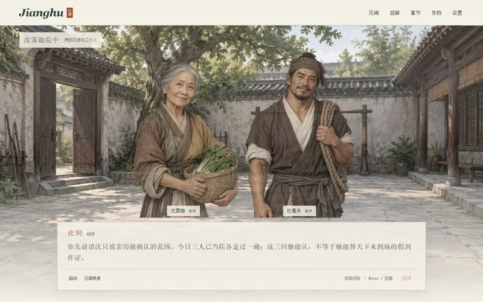
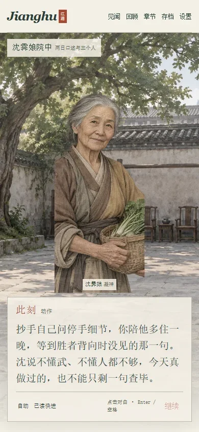
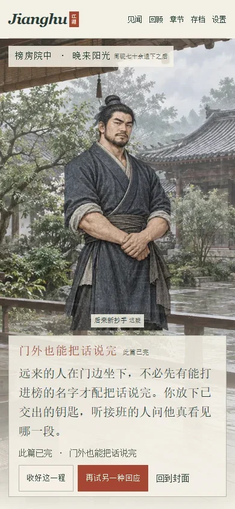
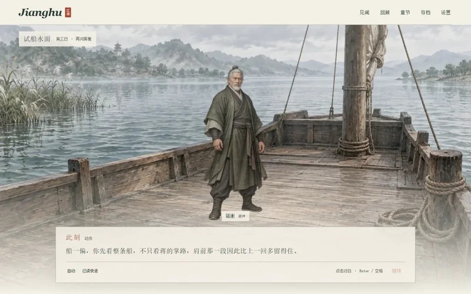
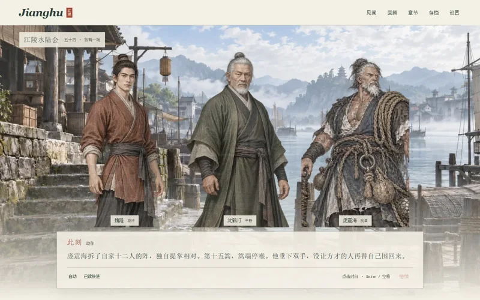
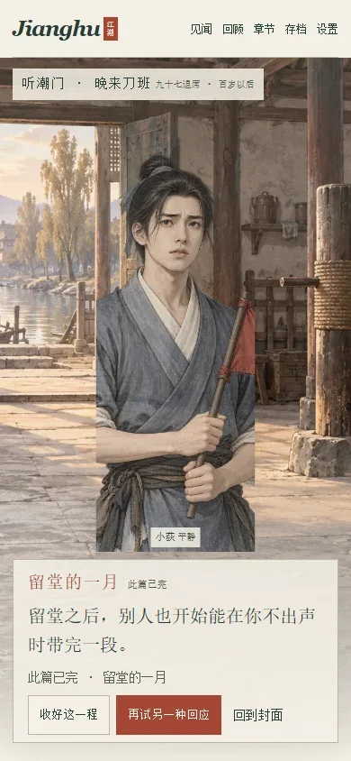

# F · 后半作品独立浏览器与演出复核

2026-10-18。**六条从封面开始的真实完整路线，1,714拍，1,526次“继续”、182次选项输入，全到结局并刷新恢复。未发现需判废产品冻结的P0/P1。** 本结论只覆盖下列实际路径与尺寸，不把自动点击称为真人试读。

采用 `frontend-testing-debugging` 与 `playwright` 技能。Browser plugin not available，依技能回退为仓库已有 Playwright/Chrome；未安装依赖，未改应用、测试、素材或编译产物。使用项目外脚本直接控制真实浏览器。首个选择每条用焦点后Enter，其余选项与全部next均真实点击；没有注入终点或中途存档。只注入关闭打字/减动效/字号20的阅读设置。

## 输入与服务

- 初始冻结产品提交 `83b5049484565940c3c163d6f3558004619ffe83`；随后测试/发布脚本RC为 `bb514bb38edf4f20d7a79cb461cfcb28156ebeba`。父审计明确后者未改story/src/public字节。本证据绑定产品文件指纹，不把提交标签变化冒称重新验证新产品。
- 死人输入 `src/generated/dead-ranking.json` SHA256 `0cba7ac64b2e068757855c8bfcaa609b93c362d60951f07819eb6efb0222d6cc`。
- 芦花输入 `src/generated/luhua.json` SHA256 `da48471815a1a8cab070524de762f917288669759f6ad35320172d1f62444b2a`。
- 三条桌面路线经 `http://127.0.0.1:4173/`；手机路线用独立4191。主fullrun取消后共享4173关闭，第一次手机默认尝试虽点到结局，但结束刷新失去服务，未据该次记录声称完成；随后完整重跑。4191后来切换为项目外**已复制dist快照**，不依赖父审计重新构建时移动的工作区dist。
- 外部根：`../Jianghu-independent-20261018\independent-late-browser`。原脚本、66张原截图、完整JSON与快照在此。`browser-late-manifest.json` 记路径/字节/SHA；`browser-late-assets.json` 对49个实际加载HTML/JS/CSS/图片等文件逐一核对4191服务响应与外部快照字节相同。

## 完整路线与真实操作

|路线|尺寸|拍|next|选项|结局|
|---|---|---:|---:|---:|---|
|dead-default|1440×900|311|277|33|dr_room_after|
|dead-mixed|1440×900|313|279|33|dr_road_after|
|luhua-mixed|1440×900|233|207|25|lh_hall_after|
|dead-default|390×844|311|277|33|dr_room_after|
|dead-mixed|390×844|313|279|33|dr_road_after|
|luhua-mixed|390×844|233|207|25|lh_hall_after|

默认路线每处选第一个合法选项。死人对照仅覆盖这些关键CID：`dr_ask_what_she_knows`、`dr_face_all_together`、`dr_ask_in_front_of_heirs`、`dr_career_visit`、`dr_road_let_next_ask`；其余仍第一项。因此会实际承受不获送返车、外访多住一晚等成本，而不是把“共桌”机械等价成坏结局。直接追钱仍保留默认 `dr_follow_land_money`，构成money=true/house=false的反例组合。

芦花混合CID：`lh_follow_plain_turns`、`lh_ask_gap_later`、`lh_wait_full_record`、`lh_share_road_first`、`lh_thank_other_school`、`lh_keep_both_results`、`lh_walk_raft_again`、`lh_return_wounded_first`、`lh_ask_why_only_once`、`lh_finish_box_then_return`；其余第一项。这实际走过四组true/false混合：焦侧线/魏另约、真守/询问一次之限、见隙试/先送药、照实演卢败/走完半年约。

六份 `browser-late-<route>-<width>.json` 均保留**每次实际输入**的原拍、CID、click或Enter、每拍真实DOM正文/发言名/场景/角色/焦点/图片URL，以及console与network事件。可按actions从开局重放；没有把oracle内部推进当作浏览器点击。

## 检查结果与具体现场

|检查|实际证据与范围|结果|
|---|---|---|
|页面身份/非空|六条入口title、URL、封面h1被记录；完整1714拍正文与实际DOM逐一相等|PASS|
|场景/角色/焦点|每拍场景ID、在场角色列表及focused角色与冻结runtime相等；NPC发言aria标识存在|PASS（该六路线）|
|布局与键盘|1714拍document无横向溢出；每个实际到达选择的两项均focus、滚入视口并校验边界；首项各一次Enter，其余真实click|PASS，字号20/两指定尺寸|
|console/network|六条pageerror、console warning/error、HTTP≥400及requestfailed均为空|PASS；服务中断那次另记未计入|
|图片decode|每条所有实际CSS背景/立绘唯一URL用Image.decode核实且naturalWidth≥100；49项服务字节与快照一致|PASS（实际加载资产）|
|框架错误层|实际关键截图未见错误覆盖层，全部正文成功推进至结局；未声称对每帧做独立overlay节点计数|未见故障|
|结束恢复|六条终点均显示ending-actions，reload后仍回相同beat|PASS|
|图像人工式复核|本代理实际打开查看22张页面原图，另看庞原始透明立绘；其余44张是自动留证，未冒称逐张细审|PARTIAL视觉覆盖|

死人：`dr_three_parts_8`明确“今日三人已当院各走过”，不再否认亲试；共桌 `dr_three_faces_1_1`/`2_1`/`after_1`正文是同桌续问/同桌说完，未再走三间屋。`dr_living_benefit_10`明确旧契中人、继业门人，与实际两个CID一致。`dr_later_teacher_6`为抄手自己问、陪住一晚，不再套堂前示范。两档截图中正文完整可见，结局三按钮可操作。场景标题仍叫“三间问话屋”，指这个场景空间，正文已明确坐在同桌；不据此再推导三次换屋。

芦花：`lh_third_day_4`正文是蒋的**掌路**，实际蒋立绘空手，没有篙。`lh_road_two_4`写陈**右肩**，实际此拍无陈立绘，因此这里只能验证文本、不能声称伤肩演出已获专用图。`lh_mainship_after_9`承认阿航已报最后一舟；晚堂`10/14/18/22`分别保留两条真实行动，不再捏造抢近、怪人研究、没走药路或隐败。手机长段可见六至七行、继续仍在底部；结局能恢复。独自墓前及老师死后没有活人孟重新站台，逐帧cast对照也支持这一点。

## P2演出建议（不改冻结产品）

1. **庞震海闲站像仍手持大锚，与此场掌战不够贴合。** 原透明图确有大锚；1440的 `lh_jiangling_6`主要可见绳索与握柄，锚头被对白舞台裁去；390连手与锚头也裁在屏外。`lh_jiangling_5/6/7`真实DOM action为空，图片固定，不存在挥锚动作、锚击台词或用锚替代十五篙胜负。故本次定P2“静态战态/道具不贴合”，不定P1“战斗兵器与历史结果被改写”。最小后续方案：补同一人物空手/收掌姿态挂到这场，保留带锚像在适合的非战场面；无需改剧情数值或胜负。
2. **通用像与裁切有明显制作痕迹。** 沈霁娘仍用持菜篮老妪、年轻抄手及小荻用持红旗青年；手机沈篮有立绘框直切。蒋与沈鹤汀分场复用相同老者像。姓名与现场角色未串，未见同屏两人同脸，故属P2辨识与动作质量。后续补专属角色姿态，并按390复看portrait大小/位置；不能以已decode取代角色美术验收。

这些是实际看图后的有限判断。Chrome之外浏览器、真机、20–40分钟真人阅读、其余选项组合与离线下载流均不由本报告声称通过。F项没有预置存档场景辅助路线；额外原图查看只用于判断庞的道具，不算完整通关。

## 精选截图（宽≤800 WebP）

